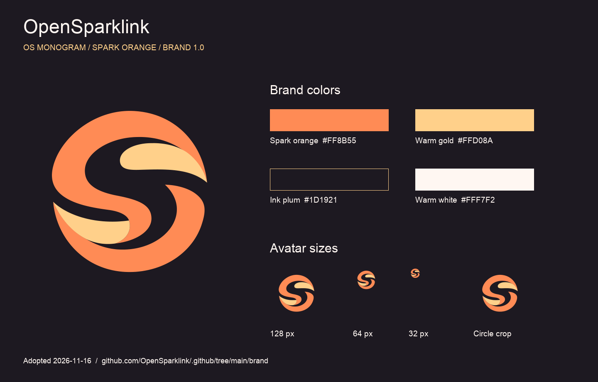

# OpenSparklink 品牌规范

状态：正式采用 · 版本：1.0.0 · 启用日期：2026-11-16

OpenSparklink 的组织标识采用 **C 方案的 O/S 融合图形 + 星火橙配色**。O 表达开放与连接，S 呼应 SparkLink；两处暖金折面延续图形的流动感。本文与 [`colors.json`](colors.json) 是组织视觉资产和品牌色的登记入口。



## 品牌色

| 角色 | 名称 | HEX | RGB | 用途 |
| --- | --- | --- | --- | --- |
| 主品牌色 | 星火橙 / Spark orange | `#FF8B55` | `255, 139, 85` | 标识主轮廓、重点识别元素 |
| 辅助色 | 暖金 / Warm gold | `#FFD08A` | `255, 208, 138` | 标识折面、少量强调 |
| 品牌底色 | 墨紫 / Ink plum | `#1D1921` | `29, 25, 33` | 头像、横幅和品牌深色背景 |
| 文本色 | 暖白 / Warm white | `#FFF7F2` | `255, 247, 242` | 深色背景上的主要文字、反白标识 |

品牌主体以墨紫衬托星火橙，暖金用于折面。浅色页面优先放置带墨紫底色的头像；需要透明底时使用 `mark.svg`，根据实际背景保持图形清晰。

颜色配置提供 [`colors.json`](colors.json) 与 [`tokens.css`](tokens.css)。新项目采用这些登记值；早期探索稿中的薄荷青、冰川蓝等配色保留在历史目录。

## 标识与导出文件

| 文件 | 用途 |
| --- | --- |
| [`assets/logo.svg`](assets/logo.svg) | 定稿矢量头像，墨紫底色，四条可编辑曲线 |
| [`assets/mark.svg`](assets/mark.svg) | 透明底彩色标识 |
| [`assets/mark-monochrome.svg`](assets/mark-monochrome.svg) | 星火橙单色标识 |
| [`assets/mark-white.svg`](assets/mark-white.svg) | 暖白反白标识，用于深色背景 |
| [`assets/avatar.png`](assets/avatar.png) | 1024 × 1024 PNG，组织头像上传原件 |
| `assets/avatar-{32,64,128,256,512}.png` | 对应像素尺寸的头像 |
| [`assets/mark.png`](assets/mark.png) | 1024 × 1024 透明底 PNG |
| [`assets/banner.svg`](assets/banner.svg) | 定稿主页横幅；`profile/assets/banner.svg` 为发布副本 |

使用时保持纵横比、O/S 负形和两处折面的比例。头像采用完整正方形画布居中裁切；现有留白适配圆形头像。建议最小显示尺寸为 32 × 32 像素。需要缩放、换尺寸或导出时，以 SVG 为源文件。

## 设计历史

[`archive/`](archive/) 保存 A / B / C 初期生成图及提示词、C 方案的矢量重绘、六组配色及对比图。历史文件用于追溯设计过程，当前组织视觉以本目录的正式资产为准。

| 决策 | 结果 |
| --- | --- |
| 图形方向 | 选择 C：O/S 融合图形 |
| 制作方式 | 手工重绘四条原生 SVG 曲线 |
| 配色方向 | 六组配色对比后选择 04：星火橙 |
| 正式采用 | 组织负责人于 2026-11-16 明确要求设为组织头像并登记为组织品牌色 |

## 维护

修改品牌色时，同时更新 `colors.json`、`tokens.css`、SVG 和本规范，保留新的版本记录。运行下列命令可从正式 SVG 重新导出头像尺寸及品牌概览，并同步主页横幅副本：

```sh
python -m pip install pymupdf pillow
python brand/tools/render_assets.py
```

各项目可以引用本仓库的品牌规范与原始资产。项目功能、标准内容、实验数据和代码许可证由对应仓库维护。
