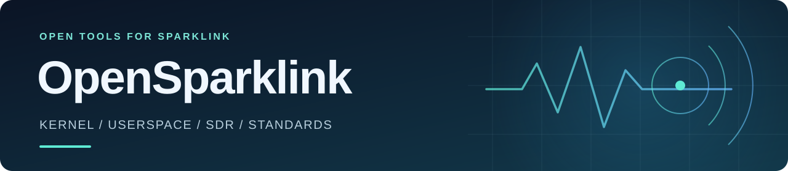

  <a href="https://github.com/OpenSparklink/linux/tree/master/net/sparklink">Linux 内核</a> ·
  <a href="https://github.com/OpenSparklink/sparklink">用户态工具</a> ·
  <a href="https://github.com/OpenSparklink/sparklink_sim">SDR 仿真</a> ·
  <a href="https://github.com/OpenSparklink/sparklink_sim/releases/tag/sle-iq-20261116-r2">实测 IQ 数据</a> ·
  <a href="https://github.com/OpenSparklink/sparklink-national-standards-pdf">国家标准</a>

围绕星闪（SparkLink）开展开源开发与技术资料整理，连接 **Linux 内核、用户态工具、无线链路仿真和实测数据**，让协议研究、应用开发和实验复现有清晰的入口。

Open tools, reproducible experiments, and shared resources for SparkLink development.

## 项目导航

| 方向 | 项目 | 主要内容 |
| --- | --- | --- |
| Linux 内核 | [linux](https://github.com/OpenSparklink/linux) | 星闪内核实现位于 [`net/sparklink/`](https://github.com/OpenSparklink/linux/tree/master/net/sparklink)，包括 SLE、传输接口、服务与安全相关模块。 |
| 用户态基础设施 | [sparklink](https://github.com/OpenSparklink/sparklink) | `libsparklink`、D-Bus 守护进程 `slkd`、命令行与监控工具，以及 C / Python 语言绑定。 |
| SDR 与链路仿真 | [sparklink_sim](https://github.com/OpenSparklink/sparklink_sim) | SLE 物理层与 MAC 仿真、调制编解码、信道与同步算法、测试用例及实验文档。 |
| 国标 PDF 归档 | [sparklink-national-standards-pdf](https://github.com/OpenSparklink/sparklink-national-standards-pdf) | GB/T 48336 与 GB/T 46803 系列共 17 份 PDF，附版本目录、来源和 SHA-256 校验值，使用 Git LFS 管理。 |

## 实测 IQ 数据集

提供由 **WS63 发射、ANTSDR E310 采集**的真实 SLE 无线波形，覆盖 GFSK、QPSK 和 8PSK，可用于离线解调、接收算法分析与 FPGA 回放测试。发布附件包含采集条件、样本索引和完整性校验文件。

**[下载实测 IQ 数据](https://github.com/OpenSparklink/sparklink_sim/releases/tag/sle-iq-20261116-r2)** · [查看格式与使用说明](https://github.com/OpenSparklink/sparklink_sim/blob/master/docs/how-to/real-iq.md)

数据集可独立下载和使用，无需安装仿真工程。

## 参与协作

欢迎贡献协议与驱动实现、仿真用例、实测数据分析、文档改进和资料纠错。

- 使用问题与可复现的缺陷，请提交到对应项目的 Issues：[用户态工具](https://github.com/OpenSparklink/sparklink/issues) · [SDR 仿真](https://github.com/OpenSparklink/sparklink_sim/issues) · [标准资料](https://github.com/OpenSparklink/sparklink-national-standards-pdf/issues)。
- 代码与文档修改通过对应仓库的 Pull Request 提交，并遵循该仓库的构建、测试和许可证说明。
